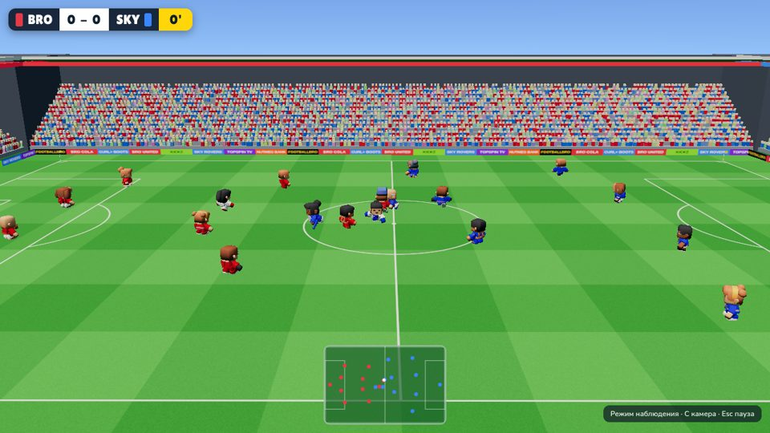
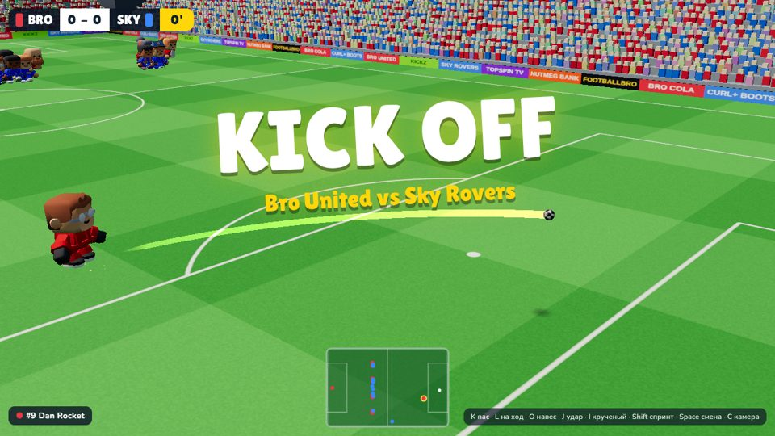
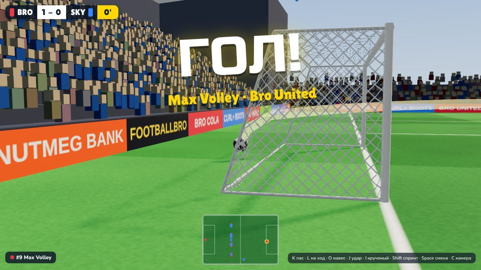
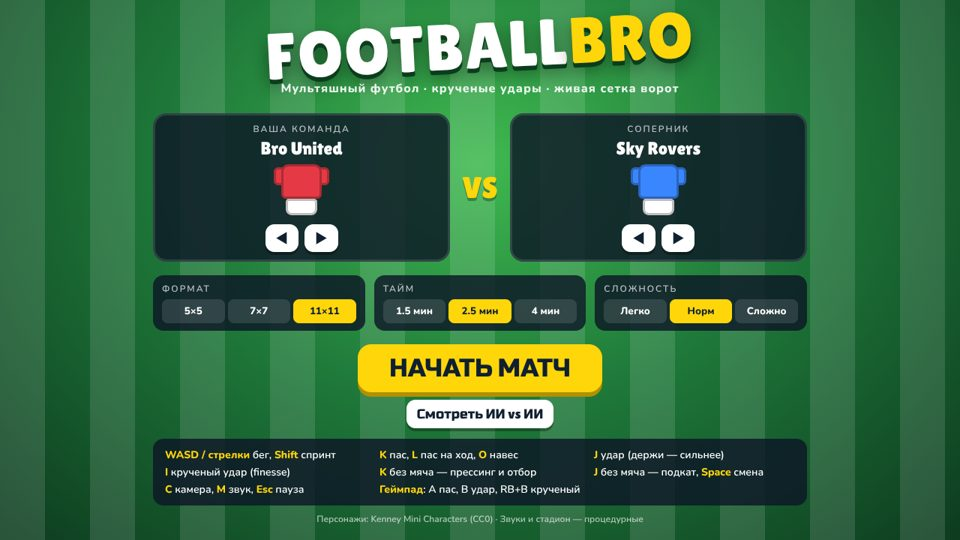

# footballbro

**Footballbro** — желейный футбол в духе Fall Guys. Ты — боб в короне, вокруг твоя команда ботов и соперники,
гигантский прыгучий мяч падает с неба, арена парит в облаках. Без аутов, офсайдов и фолов: подкаты, захваты,
удары головой и каждые полминуты случайное событие (мега-мяч, луна, гололёд, турбо, вертушка). Камера от третьего лица.
Запуск: `npm install && npm run dev` → http://localhost:5173.

| Действие | Стрелки (по умолчанию) | WASD |
|---|---|---|
| Бег (вперёд — от камеры) / спринт | стрелки / Shift | WASD / Shift |
| Удар (держать — сильнее) | D | J |
| Пас своему | S | K |
| Навес | A | L |
| Подкат рыбкой | E | I |
| Схватить соперника (держать) | R | U |
| Смена игрока (на ближнего к мячу, ещё раз — следующий) | Q | Q / O |
| Прыжок (по мячу в воздухе — удар головой) | Пробел / W | Пробел |

Когда пас доходит до партнёра, управление само переходит к нему (можно выключить в меню).
V — камера (за спиной / выше / трансляция), Esc — пауза, M — звук.

---

## Soccerbro (старая версия в стиле FIFA)

Лежит в том же репозитории как архив и источник готового кода: `classic.html` (http://localhost:5173/classic.html).

Мультяшный 3D-футбол в браузере: реалистичная физика мяча (сопротивление воздуха, эффект Магнуса — крученые удары как finesse в FIFA, отскоки с вращением), живая сетка ворот (ткань, которая прогибается и колышется), повторы голов, синтезированные звуки стадиона.

| | |
|---|---|
|  |  |
|  |  |

## Как запустить

```bash
npm install
npm run dev      # открыть http://localhost:5173
```

Сборка: `npm run build` → папка `dist/` (статические файлы, можно выложить на любой хостинг, например GitHub Pages).

## Управление

Раскладку можно поменять в **Настройках** (две готовые: «Как в FIFA» и «WASD + JKL», плюс переназначение любой клавиши).
По умолчанию — как в FIFA на клавиатуре:

| Клавиша | С мячом | Без мяча |
|---|---|---|
| Стрелки | бег | бег |
| E | спринт (тратит выносливость) | спринт |
| S | пас (держать — дальше и сильнее) | сдерживание (держать) |
| W | пас на ход | прессинг партнёром (держать) |
| A | навес / заброс | подкат |
| D | удар (держать — сильнее) | отбор |
| Shift | **крученый удар (finesse)** | — |
| Z | удар парашютом | — |
| C | финт | — |
| Q | — | смена игрока |
| V / M / Esc | камера / звук / пауза | |

Геймпад: левый стик, A — пас, B — удар, RB — крученый, LT — парашют, X — на ход, Y — навес, LB — смена, RT — спринт, R3 — финт.

## Режимы
- Формат 5×5, 7×7, 11×11 (размер поля подстраивается)
- Длина тайма 1.5 / 2.5 / 4 минуты
- Сложность ИИ: легко / норм / сложно
- «Смотреть ИИ vs ИИ»

Правила: голы, ауты, угловые, удары от ворот, штрафные и пенальти за фолы, два тайма. Офсайдов и карточек нет.

## Для разработки
- `npm test` — тесты физики мяча и управления
- `npm run sim -- 5 11 120` — прогон 5 матчей ИИ против ИИ без графики со статистикой (удары, голы, точность пасов, зависания)
- `npm run shots` — скриншоты в headless-браузере (при запущенном `npm run dev`)
- Карта проекта — в [CLAUDE.md](CLAUDE.md)

## Ассеты
- Footballbro: бобы, арена и мяч целиком процедурные (генерируются кодом)
- Soccerbro: [Kenney Mini Characters](https://kenney.nl/assets/mini-characters) (CC0)
- Стадион, мяч, сетка, звуки — процедурные (генерируются кодом)
